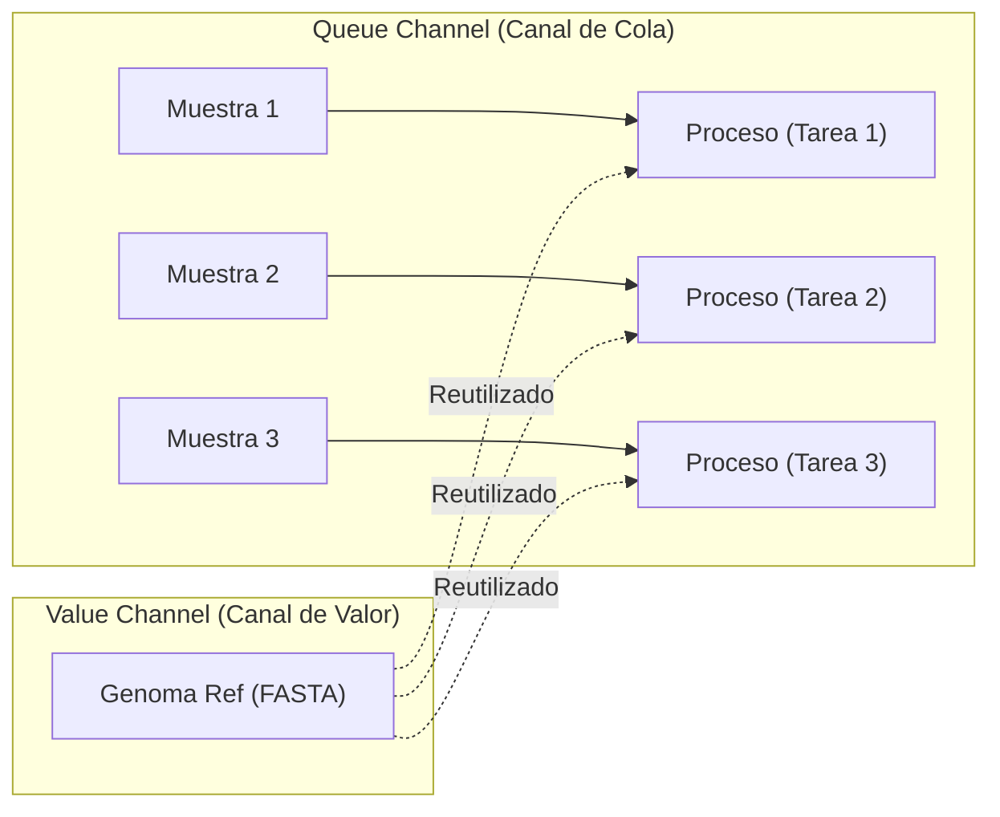

[⬅️ Lección 2 - Procesos](Leccion_02_Procesos_y_Directivas.md) | [🏠 Temario Principal](../README.md) | [Siguiente: Ejercicios M1 ➡️](Ejercicios_M1.md)

---

# 📘 Módulo 1 - Lección 3: Canales (Channels) Fundamentales

Si los procesos son los operarios de la fábrica, los **canales (**`channels`**)** son las cintas transportadoras por las que viajan los datos.

Nextflow es un lenguaje reactivo: **un proceso se ejecuta tantas veces como elementos le lleguen a través de su canal de entrada**.

---

## 1. Los 2 Tipos de Canales: Queue vs Value

Esta distinción es crucial para entender por qué tu pipeline funciona o por qué se queda esperando datos:

### A) Canales de Cola (Queue Channels)

- Son colas de tipo FIFO (First-In, First-Out).
- **Consumo destructivo:** Cada vez que un proceso toma un elemento del canal, el elemento desaparece del canal.
- Se usan para enviar **datos que cambian en cada muestra** (ej. 100 archivos FASTQ distintos).
- Se crean con la mayoría de factorías: `Channel.of(...)`, `Channel.fromPath(...)`, `Channel.fromFilePairs(...)`.


### B) Canales de Valor (Value Channels)

- Almacenan **un único valor constante**.
- **Consumo no destructivo:** Puede ser leído infinitas veces por cualquier proceso sin consumirse.
- Se usan para **datos de referencia compartidos** por todas las muestras (ej. el genoma de referencia de humano `GRCh38.fa`, o un archivo de índices).
- Se crean con `Channel.value(...)` o pasando un valor directo.




---


## 2. Factorías de Canales (Channel Factories)

Para introducir datos en Nextflow, utilizamos los métodos constructores de canales (`Channel.<metodo>`):

### 1. `Channel.of(...)`

Crea un canal a partir de una lista explícita de elementos o rangos:

```groovy
ch_muestras = Channel.of('ctrl_1', 'ctrl_2', 'tratam_1', 'tratam_2')
ch_numeros = Channel.of(1..5) // Emite 1, 2, 3, 4, 5
```


### 2. `Channel.fromPath(...)` (Cargar ficheros)

Crea un canal con los archivos que coincidan con una ruta o un patrón comodín (*glob*):

```groovy
// Un solo archivo:
ch_genoma = Channel.fromPath("data/referencias/hg38.fasta", checkIfExists: true)

// Múltiples archivos:
ch_fastqs = Channel.fromPath("data/raw/*.fastq.gz")
```

> **Buenas prácticas en Seqera / nf-core:**
> Añade **SIEMPRE** el parámetro `checkIfExists: true`. De lo contrario, si te equivocas al escribir el nombre del archivo, Nextflow creará un canal vacío silenciosamente y no te avisará de que el archivo no existe.


### 3. `Channel.fromFilePairs(...)` (El estándar para Paired-End en NGS)

En genómica y transcriptómica, las lecturas emparejadas suelen venir en parejas: `muestraA_1.fastq.gz` y `muestraA_2.fastq.gz`.

`Channel.fromFilePairs` detecta automáticamente los pares, extrae el identificador común y emite una tupla: `[id_muestra, [R1, R2]]`.

```groovy
// Patrón para capturar _1 y _2 o _R1 y _R2:
ch_reads = Channel.fromFilePairs("data/reads/*_{1,2}.fastq.gz")

// Qué contiene ch_reads:
// ['muestraA', ['/path/muestraA_1.fastq.gz', '/path/muestraA_2.fastq.gz']]
// ['muestraB', ['/path/muestraB_1.fastq.gz', '/path/muestraB_2.fastq.gz']]
```

---


## 3. Ejemplo Práctico: Conectando Canales y Procesos

Crea un script llamado `canales_demo.nf`:

```groovy
// 1. DEFINICIÓN DEL PROCESO
process ALINEAR {
    tag "$sample_id"

    input:
    val sample_id
    val ref_genome

    output:
    stdout

    script:
    """
    echo "Alineando la muestra ${sample_id} contra la referencia ${ref_genome}..."
    """
}

// 2. DEFINICIÓN DEL FLUJO DE TRABAJO (WORKFLOW)
workflow {
    // Definimos los canales DENTRO del director de orquesta
    ch_samples = Channel.of('Cancer_01', 'Cancer_02', 'Sano_01')
    ch_referencia = Channel.value("Homo_sapiens_GRCh38.fa")

    // Al pasar un Queue channel (3 muestras) y un Value channel (1 referencia)
    // Nextflow ejecuta el proceso 3 VECES automáticamente en paralelo.
    ALINEAR(ch_samples, ch_referencia)
    
    // Mostramos el resultado por consola
    ALINEAR.out.view()
}
```

En un análisis real, el comando de alineamiento (como HISAT2 o BWA) necesita leer el archivo físico para funcionar. Al pasarlo como `val`, la máquina solo recibe las letras que conforman el nombre del archivo, pero no el archivo en sí. En un entorno de producción, la carga debería hacerse con `Channel.fromPath(...)` y la entrada del proceso debería declararse como un archivo físico (`path ref_genome`) para que Nextflow genere automáticamente el enlace simbólico (symlink) en el directorio de trabajo temporal.

Ejecútalo:

```bash
nextflow run canales_demo.nf
```

Salida en consola:

```
[a0/e86ec4] ALINEAR (Cancer_01) | 3 of 3 ✔
Alineando la muestra Sano_01 contra la referencia Homo_sapiens_GRCh38.fa...
Alineando la muestra Cancer_02 contra la referencia Homo_sapiens_GRCh38.fa...
Alineando la muestra Cancer_01 contra la referencia Homo_sapiens_GRCh38.fa...
```

¡Observa la magia de Nextflow! Has escrito el código una sola vez, pero Nextflow lo ha paralelizado para cada muestra de forma transparente.

---


## 4. Inspeccionar Canales con `.view()`

Para saber qué datos están viajando en un canal en cualquier momento del desarrollo, añade el operador `.view()`:

```groovy
ch_fastqs = Channel.fromPath("*.fastq.gz")

// Opción simple:
ch_fastqs.view()

// Opción con formato descriptivo:
ch_fastqs.view { file -> "Fichero detectado: ${file.name} (Tamaño: ${file.size()} bytes)" }
```

---

| [⬅️ Lección 2 - Procesos](Leccion_02_Procesos_y_Directivas.md) | 🏠 [Temario Principal](../README.md) | [Siguiente: Ejercicios M1 ➡️](Ejercicios_M1.md) |
| :--- | :---: | :---: |