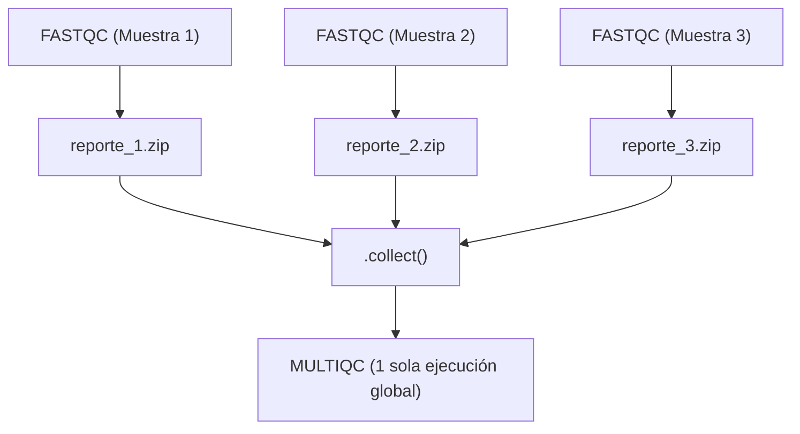

[⬅️ Módulo 1 - Test Autoevaluación](../Modulo_1_Fundamentos/Test_Autoevaluacion_M1.md) | [🏠 Temario Principal](../README.md) | [Siguiente: Lección 5 - Combinación y Tuplas Meta ➡️](Leccion_05_Combinacion_y_Tuplas_Meta.md)

---

# 📘 Módulo 2 - Lección 4: Operadores de Transformación (`map`, `filter`, `flatten`, `collect`)

Los **operadores** son métodos que se aplican a los canales para transformar, filtrar, combinar o reorganizar los datos a medida que viajan entre procesos. Son la clave para manipular metadatos y dirigir el flujo de ejecución en Nextflow.

---

## 1. El operador `.map` (Transformación elemento a elemento)

El operador `.map` aplica una función a cada elemento que pasa por el canal, devolviendo un nuevo elemento transformado.

### Ejemplo 1: Modificar valores simples
```groovy
Channel
    .of('control_1', 'tratamiento_1')
    .map { sample -> sample.toUpperCase() }
    .view()
// Salida:
// CONTROL_1
// TRATAMIENTO_1
```

### Ejemplo 2: Modificar tuplas (Estructurar metadatos en Bioinformática)
Imagina que recibes un archivo y quieres añadirle un ID y un tipo de muestra:
```groovy
Channel
    .fromPath("data/*.fastq.gz")
    .map { file -> 
        def sample_id = file.simpleName // Extrae el nombre sin extensiones
        return tuple(sample_id, file)
    }
    .view()
// Salida:
// [muestra1, /path/to/muestra1.fastq.gz]
// [muestra2, /path/to/muestra2.fastq.gz]
```

---

## 2. El operador `.filter` (Filtrado condicional)

El operador `.filter` evalúa una condición booleana para cada elemento. Solo deja pasar aquellos que cumplan la condición (los que devuelven `true`).

```groovy
Channel
    .of(1, 2, 3, 4, 5, 6, 7, 8, 9, 10)
    .filter { it % 2 == 0 } // 'it' representa el elemento actual en Groovy
    .view()
// Salida: 2, 4, 6, 8, 10
```

### Ejemplo bioinformático: Filtrar por tipo de muestra
```groovy
ch_muestras = Channel.of(
    [id: 'P1', tipo: 'Tumor',  file: 'p1_tumor.bam'],
    [id: 'P2', tipo: 'Control', file: 'p2_ctrl.bam'],
    [id: 'P3', tipo: 'Tumor',  file: 'p3_tumor.bam']
)

// Quedarnos solo con las muestras tumorales:
ch_muestras
    .filter { item -> item.tipo == 'Tumor' }
    .view { item -> "Analizando tumor: ${item.id}" }
```

---

## 3. El operador `.flatten` (Aplanar listas)

Cuando un canal emite una lista de elementos (por ejemplo, `[1, 2, 3]`), `.flatten` descompone esa lista y emite cada elemento por separado, uno a uno.

```groovy
Channel
    .of( ['A', 'B'], ['C', 'D', 'E'] )
    .flatten()
    .view()
// Salida:
// A
// B
// C
// D
// E
```

### ¿Cuándo se usa en bioinformática?
Cuando un proceso de control de calidad o alineamiento genera una lista de múltiples archivos (ej. 10 gráficos por muestra) y necesitas que el siguiente proceso analice cada gráfico de forma individual.

---

## 4. El operador `.collect` (Agrupar todo en una lista única)

`.collect` es el opuesto directo de `.flatten`. Espera a que el canal termine de emitir **todos sus elementos** y los junta todos en una **única lista**.

```groovy
Channel
    .of('MuestraA', 'MuestraB', 'MuestraC')
    .collect()
    .view()
// Salida:
// [MuestraA, MuestraB, MuestraC]
```

### 🚨 La regla de oro en Bioinformática con `.collect`:
Muchos procesos procesan muestras una a una en paralelo (ej. FastQC corre 100 veces, una por muestra).
Pero herramientas de reporte como **MultiQC** necesitan recibir **TODOS los reportes juntos a la vez** para generar un único HTML resumen global.

Para conectar 100 salidas individuales de FastQC con 1 sola ejecución de MultiQC, se utiliza **`.collect()`**:

```groovy
workflow {
    FASTQC(ch_fastqs)

    // FASTQC.out emite 1 reporte por cada muestra (100 elementos)
    // Usamos .collect() para esperar a los 100 y pasárselos juntos a MULTIQC:
    MULTIQC(FASTQC.out.zip.collect())
}
```



---

| [⬅️ Módulo 1 - Test Autoevaluación](../Modulo_1_Fundamentos/Test_Autoevaluacion_M1.md) | 🏠 [Temario Principal](../README.md) | [Siguiente: Lección 5 - Combinación y Tuplas Meta ➡️](Leccion_05_Combinacion_y_Tuplas_Meta.md) |
| :--- | :---: | :---: |
