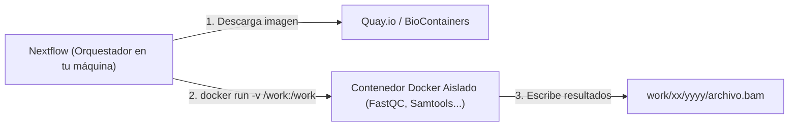

[⬅️ Lección 8 - Configuración y Parámetros](Leccion_08_Nextflow_Config_y_Params.md) | [🏠 Temario Principal](../README.md) | [Siguiente: Ejercicios M3 ➡️](Ejercicios_M3.md)

---

# 📘 Módulo 3 - Lección 9: Contenedores con Docker y Singularity

En bioinformática, instalar software tradicionalmente requería compilar librerías en C, lidiar con versiones incompatibles de Python, Java o Perl, y sufrir el llamado *"dependency hell"* (infierno de dependencias).

**Nextflow resuelve esto convirtiendo los contenedores en ciudadanos de primera clase.**

---

## 1. ¿Cómo interactúa Nextflow con Docker?

Nextflow **NO** te obliga a escribir comandos de Docker a mano (`docker run ...`). Nextflow se encarga de todo entre bastidores:

1. Lee la directiva `container` de tu proceso o configuración.
2. Si la imagen no está en tu equipo, la **descarga automáticamente** de Docker Hub o Quay.io.
3. Monta de forma transparente la carpeta temporal `work/` como volumen dentro del contenedor.
4. Ejecuta el script de tu proceso **dentro del contenedor aislado**.
5. Guarda las salidas en tu máquina real y apaga el contenedor.



---

## 2. El Ecosistema BioContainers

No necesitas crear tus propios archivos `Dockerfile` para la inmensa mayoría de herramientas estándar.
La iniciativa comunitaria **BioContainers** (`quay.io/biocontainers`) mantiene imágenes oficiales precompiladas para miles de herramientas bioinformáticas.

### Cómo asignar un contenedor a un proceso:
```groovy
process FASTQC {
    // Imagen oficial de BioContainers:
    container 'quay.io/biocontainers/fastqc:0.12.1--hdfd78af_0'

    input:
    tuple val(meta), path(reads)

    output:
    path "*.html"

    script:
    """
    # Dentro de este contenedor, 'fastqc' ya está instalado y disponible:
    fastqc ${reads}
    """
}
```

---

## 3. Configurar Docker en `nextflow.config`

Para indicarle a Nextflow que active Docker globalmente o en un perfil:

```groovy
// nextflow.config
docker {
    enabled = true
    // Permisos de usuario para que los archivos generados pertenezcan a tu usuario en Linux:
    runOptions = '-u $(id -u):$(id -g)'
}
```

### Directiva por nombre de proceso (`withName:`):
Si prefieres no poner la URL del contenedor dentro del archivo `.nf`, puedes centralizar todas las imágenes en el `nextflow.config`:

```groovy
process {
    withName: 'FASTQC' {
        container = 'quay.io/biocontainers/fastqc:0.12.1--hdfd78af_0'
    }
    withName: 'MULTIQC' {
        container = 'quay.io/biocontainers/multiqc:1.21--pyhdfd78af_0'
    }
    withName: 'HISAT2_ALIGN' {
        container = 'quay.io/biocontainers/hisat2:2.2.1--h87f3022_2'
    }
}
```

---

## 4. Docker vs Singularity (Apptainer)

En tu portátil con WSL o en la nube de AWS se utiliza **Docker**.
Sin embargo, en la mayoría de supercomputadores y clústeres hospitalarios/universitarios (HPC con SLURM), los administradores prohíben Docker por motivos de seguridad (Docker requiere permisos de superusuario `root`).

En su lugar, los clústeres usan **Singularity** (también llamado **Apptainer**).

**La genialidad de Nextflow:**
Nextflow puede convertir la misma imagen de Docker al formato de Singularity automáticamente. Solo necesitas cambiar el perfil:
```bash
# En tu portátil (con Docker):
nextflow run main.nf -profile docker

# En el clúster (con Singularity):
nextflow run main.nf -profile singularity
```

En el `nextflow.config`:
```groovy
profiles {
    docker {
        docker.enabled = true
        singularity.enabled = false
    }
    singularity {
        singularity.enabled    = true
        singularity.autoMounts = true
        docker.enabled         = false
    }
}
```

---

## 5. Probar tu primer proceso con Docker

Crea un archivo de prueba `test_docker.nf`:

```groovy
process PROBAR_SAMTOOLS {
    container 'quay.io/biocontainers/samtools:1.19.2--h50ea8bc_1'

    output:
    stdout

    script:
    """
    samtools --version
    """
}

workflow {
    PROBAR_SAMTOOLS()
    PROBAR_SAMTOOLS.out.view()
}
```

Y ejecútalo con `-with-docker`:
```bash
nextflow run test_docker.nf -with-docker
```

Observarás cómo Nextflow descarga la imagen de Samtools, la ejecuta y muestra la versión por pantalla, ¡sin que tengas Samtools instalado en tu ordenador!

---

| [⬅️ Lección 8 - Configuración y Parámetros](Leccion_08_Nextflow_Config_y_Params.md) | 🏠 [Temario Principal](../README.md) | [Siguiente: Ejercicios M3 ➡️](Ejercicios_M3.md) |
| :--- | :---: | :---: |
