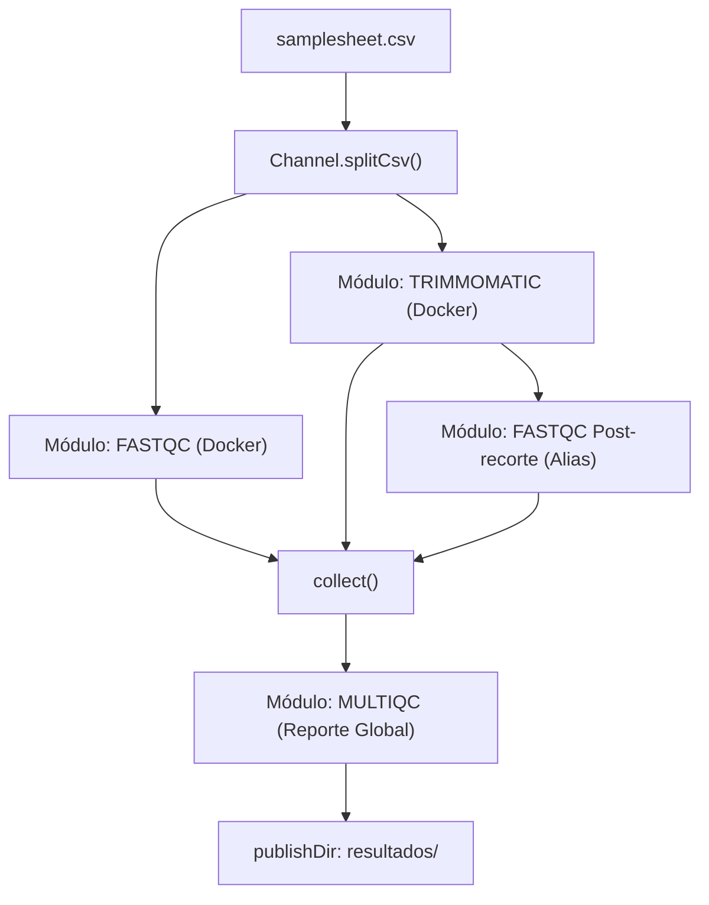

[⬅️ Hito 2: Pipeline Robusto](../Modulo_4_Depuracion_HPC_y_Cloud/Practica_Hito_2_Pipeline_Robusto.md) | [🏠 Temario Principal](../README.md)

---

# 🎓 Proyecto Final de Graduación: Pipeline Modular de Control de Calidad y Transcriptómica NGS

Este proyecto final es la piedra angular del curso. Su propósito es que construyas con tus propias manos un pipeline en Nextflow DSL2 de nivel profesional, modular, contenerizado y listo para producción.

Al completarlo, dominarás cada directiva, canal, operador y parámetro, estando plenamente capacitado/a para defender su diseño y arquitectura técnica en entornos biotecnológicos de primer nivel (Seqera, Illumina, centros de investigación o industria biofarmacéutica).

---

## 🎯 Título Recomendado del Repositorio
**`nf-rnaseq-qc: A Modular Nextflow DSL2 Pipeline for Automated Transcriptomic QC and Pre-processing`**

---

## 🏗️ Requisitos Técnicos y Arquitectura del Pipeline

El pipeline debe procesar datos de secuenciación masiva (RNA-seq en *Paired-End*), realizar el control de calidad previo, recorte de adaptadores y filtrado de lecturas de baja calidad, control de calidad posterior y consolidación de reportes agregados interactivos con MultiQC.



---

## 📋 Entregables del Proyecto

Tu repositorio final debe contener exactamente esta arquitectura:

```
nf-rnaseq-qc/
├── README.md                      # Documentación completa con instrucciones, diagrama y ejemplos
├── main.nf                        # Punto de entrada y orquestador del workflow
├── nextflow.config                # Configuración modular, perfiles (test, docker) y recursos
├── assets/
│   ├── samplesheet.csv            # Hoja de muestras de ejemplo
│   └── multiqc_config.yaml        # Configuración visual de MultiQC (opcional)
├── data/                          # Datos de prueba ligeros para ejecución inmediata
│   ├── Sample1_R1.fastq.gz
│   ├── Sample1_R2.fastq.gz
│   ├── Sample2_R1.fastq.gz
│   └── Sample2_R2.fastq.gz
└── modules/
    ├── fastqc.nf                  # Módulo atómico de control de calidad con FastQC
    ├── trimmomatic.nf             # Módulo atómico de recorte y filtrado
    └── multiqc.nf                 # Módulo de consolidación MultiQC
```

---

## 🛠️ Especificaciones Detalladas

### 1. `nextflow.config` Profesional
- **Metadatos del pipeline:** Bloque `manifest { name = 'nf-rnaseq-qc', author = '...', ... }`.
- **Scopes declarativos:** `params`, `process`, `docker`, `profiles`.
- **Perfiles de ejecución:**
  - `standard`: Ejecución local.
  - `docker`: Contenedores activados con imágenes de BioContainers y mapeo UID/GID (`runOptions = '-u $(id -u):$(id -g)'`).
  - `singularity`: Contenedores Singularity/Apptainer con automounts para clústeres HPC.
  - `test`: Parámetros predefinidos apuntando a los archivos de prueba ligeros para que cualquiera pueda probar el pipeline con un solo comando:
    ```bash
    nextflow run main.nf -profile test,docker
    ```
- **Reportes automáticos:** Directivas declarativas para `report`, `timeline`, `trace` y `dag`.

### 2. Módulos Atómicos en DSL2
- Cada módulo debe incluir directivas `tag "$meta.id"`, `label`, `container` y `publishDir`.
- Debe implementarse el patrón de diseño estándar `tuple val(meta), path(reads)`.
- Uso de `emit:` explícito para todas las salidas para conectar canales limpiamente en `main.nf`.
- Reutilización de módulos mediante alias (`include { FASTQC as FASTQC_RAW } ...` e `include { FASTQC as FASTQC_TRIMMED } ...`).

### 3. `README.md` del Repositorio de GitHub
Un buen bioinformático se distingue por la claridad y rigor de su documentación. Tu `README.md` debe incluir:
- **Badges:** Nextflow, Docker y licencia.
- **Diagrama de flujo del pipeline** (sintaxis Mermaid).
- **Requisitos previos** (Nextflow 22+, Docker o Singularity).
- **Guía de inicio rápido en 1 comando:** `nextflow run . -profile test,docker`.
- **Estructura del `samplesheet.csv`** explicando cada columna requerida.
- **Descripción de las herramientas utilizadas** y enlaces a sus citas bibliográficas oficiales.

---

## 🎓 Criterios de Evaluación y Calidad
Para considerar el proyecto completado con éxito, verifica los siguientes puntos:
1. **Ejecutabilidad limpia:** Que corra de principio a fin sin fallos con `nextflow run main.nf -profile test,docker`.
2. **Determinismo y Caché:** Que al ejecutarlo por segunda vez con `-resume` todas las tareas salgan marcadas como `[Cached]`.
3. **Calidad de código Groovy/DSL2:** Canales limpios, operadores bien elegidos, sin código duplicado.
4. **Documentación:** Que el `README.md` sea impecable, claro y profesional para ser presentado en cualquier cartera técnica bioinformática.

---

| [⬅️ Hito 2: Pipeline Robusto](../Modulo_4_Depuracion_HPC_y_Cloud/Practica_Hito_2_Pipeline_Robusto.md) | 🏠 [Temario Principal](../README.md) |
| :--- | :---: |
