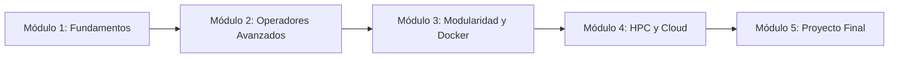

# 🧬 Curso Completo de Nextflow DSL2 & Pipelines Bioinformáticos
### *De Cero a Nivel Profesional para la Industria Biotecnológica*

Bienvenido/a a este curso abierto, intensivo y estructurado sobre **Nextflow DSL2** y diseño de pipelines bioinformáticos reproducibles. 

Este repositorio está organizado como un curso interactivo de **múltiples páginas**, guiándote paso a paso desde los fundamentos de la programación reactiva basada en datos (*Dataflow*) hasta la orquestación a gran escala en clústeres HPC y la nube.

---

## 🗺️ Mapa de Ruta del Curso



---

## 📚 Índice de Contenidos

### 🔹 Módulo 1: Fundamentos de Nextflow DSL2
Domina las bases de la ejecución reactiva, la estructura de un pipeline, la anatomía de los procesos y la creación de canales.

| # | Documento / Lección | Temas Principales |
| :-: | :--- | :--- |
| **01** | [📖 Lección 1: Introducción, Filosofía y Estructura](Modulo_1_Fundamentos/Leccion_01_Introduccion_y_Filosofia.md) | Paradigma Dataflow, reactividad, los 3 pilares, primer pipeline `main.nf`. |
| **02** | [📖 Lección 2: Procesos, Entradas, Salidas y Directivas](Modulo_1_Fundamentos/Leccion_02_Procesos_y_Directivas.md) | Bloques `input:`, `output:`, `script:`, calificadores (`val`, `path`, `tuple`), directivas (`publishDir`, `cpus`, `memory`). |
| **03** | [📖 Lección 3: Canales (Channels) Fundamentales](Modulo_1_Fundamentos/Leccion_03_Canales_Fundamentales.md) | Queue channels vs Value channels, factorías (`Channel.of`, `fromPath`, `fromFilePairs`), operador `.view()`. |
| **🏋️** | [🏋️ Ejercicios Prácticos del Módulo 1](Modulo_1_Fundamentos/Ejercicios_M1.md) | Conteo de líneas por muestra, scripts integrados en Python para %GC, lecturas paired-end. |
| **📝** | [📝 Test de Autoevaluación del Módulo 1](Modulo_1_Fundamentos/Test_Autoevaluacion_M1.md) | 10 preguntas de opción múltiple para validar los conceptos clave. |

---

### 🔹 Próximos Módulos *(En desarrollo progresivo)*
- **Módulo 2: Operadores y Canales Avanzados:** Transformación (`map`, `filter`), combinación (`combine`, `join`), tuplas de metadatos `[meta, reads]`, ramificación (`branch`, `multiMap`).
- **Módulo 3: Modularidad, Configuración y Contenedores:** Subworkflows, módulos DSL2 reutilizables, directivas dinámicas por etiquetas, integración con Docker, Singularity y Conda.
- **Módulo 4: Depuración, HPC y Cloud:** Mecanismo `-resume`, inspección del árbol `work/`, estrategias ante errores (`retry`, `ignore`), monitorización y Seqera Platform / AWS Batch.
- **Módulo 5: Proyecto Final de Graduación:** Pipeline NGS modular de control de calidad y alineamiento de extremo a extremo, listo para producción y cartera técnica.

---

## 🚀 Requisitos Previos e Instalación

Para poner en práctica los ejemplos y ejercicios de este curso, se recomienda disponer de:

1. **Linux, macOS o Windows con WSL2 (Ubuntu 22.04 LTS o superior).**
2. **Java 17 o superior:**
   ```bash
   java -version
   ```
3. **Nextflow (versión 23.04 o superior):**
   ```bash
   curl -s https://get.nextflow.io | bash
   sudo mv nextflow /usr/local/bin/
   nextflow info
   ```
4. **Motor de contenedores (opcional para Módulo 1, recomendado para módulos avanzados):** Docker o Singularity/Apptainer.

---

## 🎯 Metodología de Aprendizaje Recomendada

1. **Lectura activa e interactiva:** Sigue el orden secuencial de las lecciones utilizando la barra de navegación situada al principio y al final de cada página.
2. **Experimentación práctica:** Copia y ejecuta los fragmentos de código en tu propia terminal para observar cómo Nextflow aísla las tareas en directorios hash dentro de `work/`.
3. **Resolución de problemas:** Realiza los desafíos propuestos de cada módulo antes de consultar soluciones.
4. **Autoevaluación:** Responde a los tests conceptuales para afianzar la arquitectura interna de Nextflow.

---

## 📖 Recursos y Documentación Oficial

- [Documentación Oficial de Nextflow](https://www.nextflow.io/docs/latest/)
- [Seqera Training Platform](https://training.seqera.io/)
- [Guías de Buenas Prácticas de nf-core](https://nf-co.re/docs/guidelines/components/modules)
- [Nextflow Slack Community](https://www.nextflow.io/slack-invite.html)

---

## 👤 Autora / Mantenimiento

Repositorio creado y mantenido por [@menmati](https://github.com/menmati).
Contribuciones, mejoras y sugerencias son bienvenidas a través de Pull Requests e Issues.
